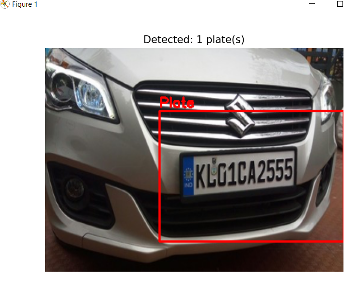

# R-CNN Number Plate Detection

A course project demonstrating a classic **Region-based Convolutional Neural Network (R-CNN)** pipeline for vehicle number-plate detection. It combines OpenCV Selective Search region proposals with a custom TensorFlow/Keras binary classifier, then uses Non-Maximum Suppression (NMS) to reduce duplicate detections.

> This is an educational prototype, not a production-ready ANPR system. The reported training-split accuracy is not a measure of end-to-end plate-detection accuracy; see [Evaluation notes](#evaluation-notes).

## How it works

1. **Generate region proposals:** OpenCV Selective Search proposes candidate image regions.
2. **Create training patches:** `Read_Annotation.py` loads the annotated plate crop, then mines additional positive proposals (IoU > 0.7) and background proposals (IoU < 0.1). Crops are resized to 128 × 128.
3. **Train a binary classifier:** The CNN predicts whether each crop contains a number plate.
4. **Detect plates:** `main.py` runs Selective Search on `Cars0.png`, classifies up to 500 proposals, keeps predictions above 0.8 confidence, and applies NMS with a 0.5 overlap threshold.

**Important:** The current `main.py` trains a new model every time it runs, saves it as `Base_model_keras.keras`, and then loads that saved model for the `Cars0.png` demo. It does not provide a separate inference-only command.

## Repository contents

```text
.
├── Base_model_keras.keras   # Saved Keras model (main.py overwrites it after training)
├── Lab17_NMS_IoU.py         # IoU and Non-Maximum Suppression helpers
├── Read_Annotation.py       # Loads annotations and creates mined training patches
├── main.py                  # Trains the CNN and runs the Cars0.png detection demo
├── numberplates/
│   ├── annotations.csv      # Image dimensions and plate bounding-box coordinates
│   └── Cars0.png ...        # Annotated vehicle images
├── demo/
│   └── result.png           # Example result image
└── requirements.txt         # Python dependency list (see installation note)
```

The annotation CSV uses the columns `filename,width,height,xmin,ymin,xmax,ymax`; bounding boxes are pixel coordinates.

## Model

The classifier takes 128 × 128 × 3 image crops and consists of four convolution/max-pooling blocks (32, 64, 128, and 256 filters), followed by dense layers and a sigmoid binary output. It is compiled with binary cross-entropy and Adam (learning rate 0.001), and trained for 20 epochs in `main.py`.

## Setup

Use a Python version supported by your TensorFlow installation. From the repository root, install the packages used by the scripts:

```bash
python -m pip install numpy pandas matplotlib scikit-learn tensorflow opencv-contrib-python
```

`opencv-contrib-python` is needed for `cv2.ximgproc` Selective Search. Do not install it alongside `opencv-python` in the same environment; both provide the `cv2` module.

> **Dependency-file note:** The current `requirements.txt` lists `os`, which is part of Python and is not installable with pip, and does not list `scikit-learn`, which `main.py` imports. The install command above avoids those issues. The requirements file can be corrected separately.

## Run the demo

Run from the repository root so the relative dataset paths resolve:

```bash
python main.py
```

The script loads annotations and images, generates Selective Search training samples, randomly splits those patches into training and evaluation subsets, trains for 20 epochs, prints the evaluation accuracy, saves the model, and displays the detection result for `numberplates/Cars0.png`.

The first run can take time because Selective Search is run over the annotated images to prepare training samples. The detection stage also processes up to 500 proposals for the demo image.

## Example result



## Evaluation notes

The printed accuracy is computed on a random split of generated **image patches**, not on a held-out set of whole vehicle images or on end-to-end bounding-box detections. Patches from the same source image can therefore appear in both subsets. For a meaningful generalization estimate, split source images before generating patches and report detection metrics such as precision, recall, and IoU on held-out images. The repository description's accuracy figure should not be interpreted as a verified detection benchmark without that evaluation.

## Implementation files

- `main.py` — CNN definition, patch-level training/evaluation, Selective Search inference, confidence filtering, NMS, and visualization.
- `Read_Annotation.py` — annotation loading and positive/negative patch generation.
- `Lab17_NMS_IoU.py` — IoU calculation and NMS implementation.

## Author

**Saqib Shah**  
BSCS (AI), Semester 6  
Pir Mehr Ali Shah Arid Agriculture University Rawalpindi
